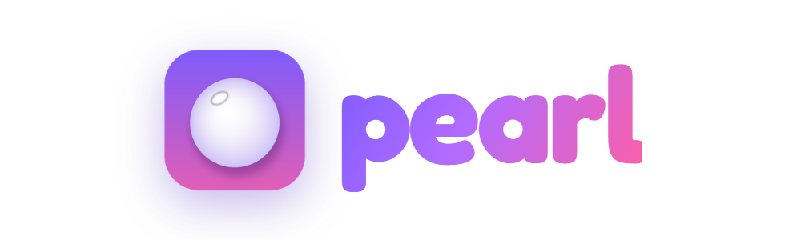
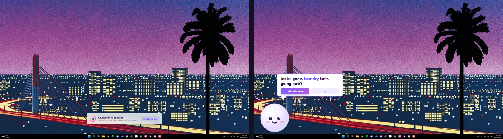
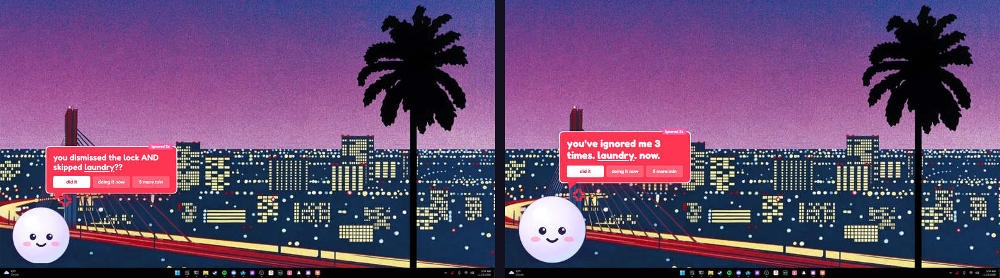
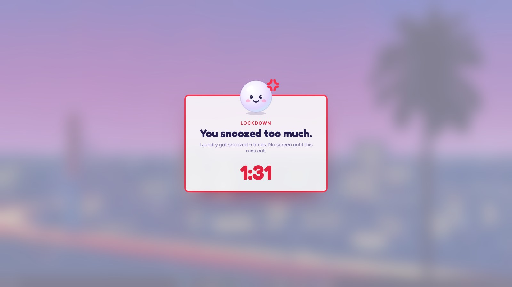
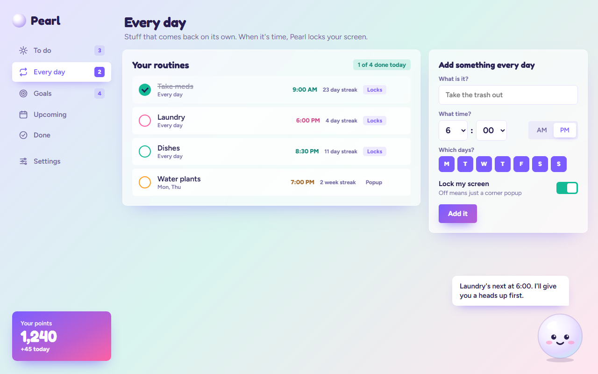
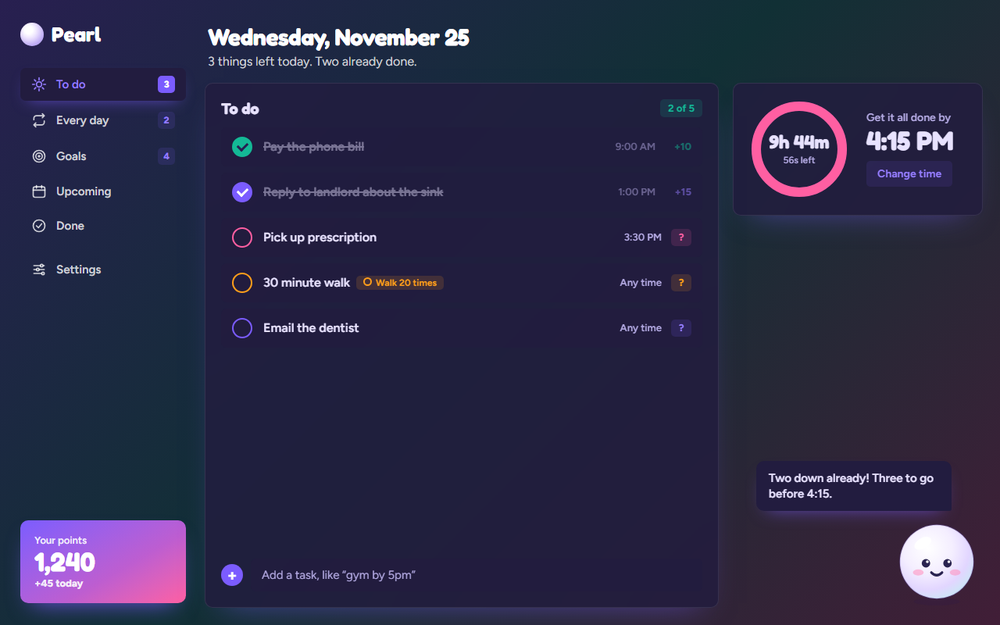
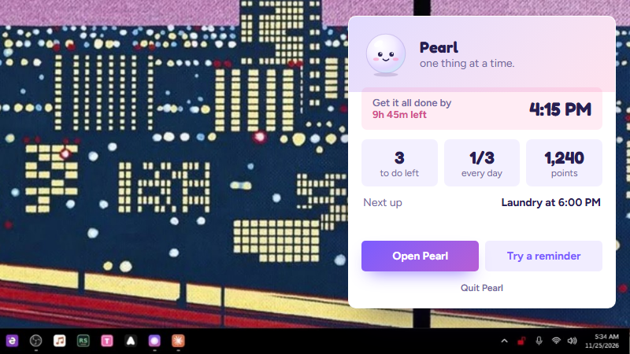
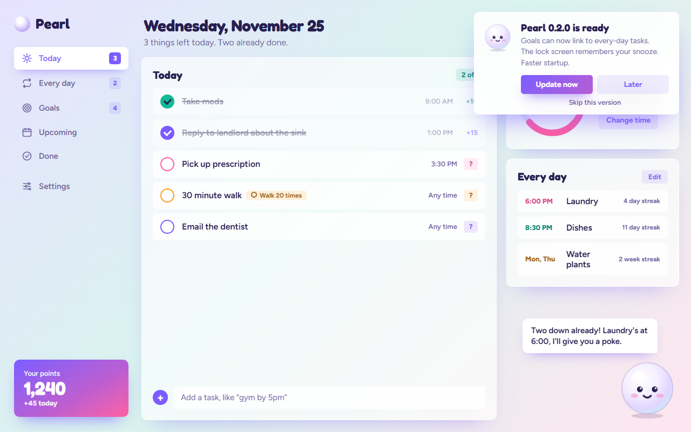
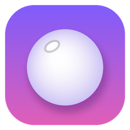

<p align="center">
  
</p>

<p align="center">
  <b>a to do app for people who know exactly what they need to do and still dont do it</b>
</p>

<p align="center">
  
  
  
  
</p>

<p align="center">
  
</p>

## why this exists

are you lazy as shit and cant remember shit and feel like you need some slop to remind you to do some shit well heres pearl my solution to being a lazy bum

pearl doesnt let you swipe it away. when something is due it takes over your screen, and if you dismiss it anyway your mascot climbs out of the corner and keeps asking until you admit youre doing it because life needs more popups in 2026

> [!WARNING]
> **snooze too much and it locks you out.** if you snooze the same thing more than 3 times, every snooze after that has a random chance to lock your whole screen for 1 to 2 minutes. no dismiss button, no closing it, it just counts down. the more you snooze and ignore the mascot, the more likely it is and the longer it lasts. reminders are off until you turn them on in settings, pearl never touches your files or anything else, and ctrl+alt+del still works if you actually need out (windows doesnt let any app block that). more below

<br>

## it actually stops you

<p align="center">
  
</p>

<p align="center">
  
</p>

1. **heads up.** 15 seconds before, a little bar shows up at the bottom so you can pause your game
2. **the lock.** everything goes soft and blurry with the task in the middle. start it, snooze it, or dismiss it if you really have to
3. **the mascot.** dismissed it? your mascot pops out of the bottom corner and asks if youre gonna go do it now. say no, hit 5 more min or just ignore him and he comes back every few minutes, a little angrier each time, until you hit **did it**. these are pearls own popups, not windows notifications you can ignore

<p align="center">
  
</p>

<br>

## snooze punishment

<p align="center">
  
</p>

this one is mean on purpose so here it is up front:

- snoozing is fine the first 3 times
- after that, **every snooze has a random chance to lock your screen for 1 to 2 minutes**. no dismiss, no snooze, no closing it. you just sit there and think about the laundry
- it starts around a 1 in 5 chance and goes up with every snooze, and ignoring the mascot makes it more likely too. more snoozes also make it last longer, up to 2 minutes
- when it runs out the mascot is right back asking if youre doing it
- it only ever happens to reminders you turned on yourself. it doesnt touch your files, your games or anything else, it just sits on top of your screen
- ctrl+alt+del always works if you really need out. windows doesnt let any app block that

<br>

## your day

- a to do list like microsoft to do but way less dogshit. type "gym by 5pm" and it sets the time
- starts empty. no fake example junk, everything in it is yours and you can delete anything
- pick a time like **4:15pm** to have everything done by and watch the countdown all day incremental fans wya 
- every day stuff like laundry, dishes or meds comes back on its own at its time, keeps a streak going and gets saved
- finishing something rolls you **random points**, and every now and then you hit a lucky roll worth triple which does absolutely nothing except maybe get added to a leaderboard eventually

<p align="center">
  
</p>

<br>

## goals

<p align="center">
  
</p>

for the bigger stuff. track them however makes sense:

| type | example |
| --- | --- |
| times | walk 20 times this month |
| amount | save $300 for a new monitor |
| streak | laundry every day for 2 weeks |
| weekly | in bed by 1am, 5 nights a week |
| percent | drag the bar to wherever youre at |
| steps | break it into steps and the bar fills up as you check them off |

link a goal to a task and finishing the task counts toward it automatically

<br>

## make it yours

<p align="center">
  
</p>

- six color sets to start from, or pick every color yourself
- **dark mode**, or set it to go by the clock: light at 6am, dark at 6pm
- pick a **window color** for the cards and popups and the text stays readable on it
- background can be the pearl mix (with your own pearl colors if you want), a gradient or one solid color
- five fonts, from clean to handwritten
- **your own mascot.** drop in any png with no background and it becomes your little guy. no feeding it or keeping it alive, it just shows up to hype you up when you get stuff done

<p align="center">
  
</p>

<p align="center">
  
</p>

<br>

## little extras

- **lives in your tray.** closing pearl just tucks it into the tray so reminders keep working. click the tray icon and a little window pops up with your countdown, whats left and whats next, kind of like mullvad. right click it to really quit
- **starts with windows** if you turn it on, straight into the tray

<p align="center">
  
</p>

- **discord status.** show that youre on pearl. your goals stay private unless you pick one to show off, and then friends see how close you are
- **updates itself.** checks when you open it, and theres a button in settings too

<p align="center">
  
</p>

<br>

## get it

grab the installer from [releases](../../releases/latest) and pearl keeps itself updated from there

## where its at

- [x] the look, colors, fonts and backgrounds
- [x] goals with all six kinds of tracking
- [x] random points
- [x] discord status
- [x] updates itself
- [x] the screen lock running on its own schedule
- [x] mascot popping up and getting mad when you ignore him
- [x] snooze punishment
- [x] dark mode, window colors, tray widget
- [x] saving your to dos, every day stuff, goals and points
- [x] feels like an actual app, not a web page
- [ ] android, with your settings synced between both

<br>

## running it yourself

you need node and rust

```
npm install
npm run dev
```

just want to look at the ui in a browser

```
npm run preview
```

## putting out an update

```
npm run release -- 0.2.0 "what changed" "another thing that changed"
```

that bumps the version, builds and signs the installer right on your pc, then pushes and posts the release to github. takes a couple minutes and everyone who has pearl gets it next time they open it or hit check for updates

<br>

<p align="center">
  <br>
  <sub>made by someone who should probably be doing laundry right now</sub>
</p>
