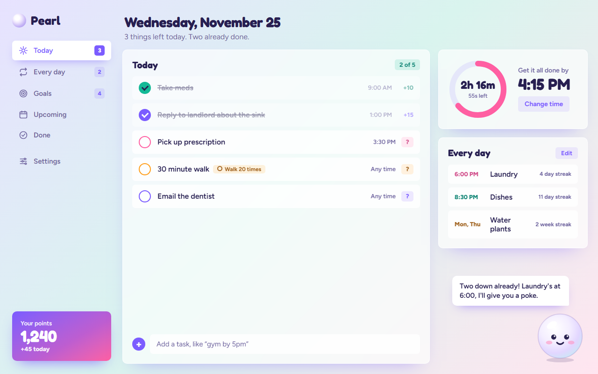
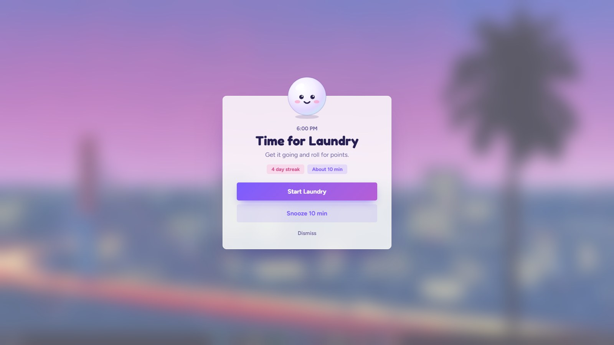
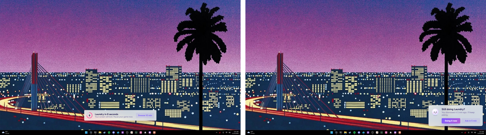
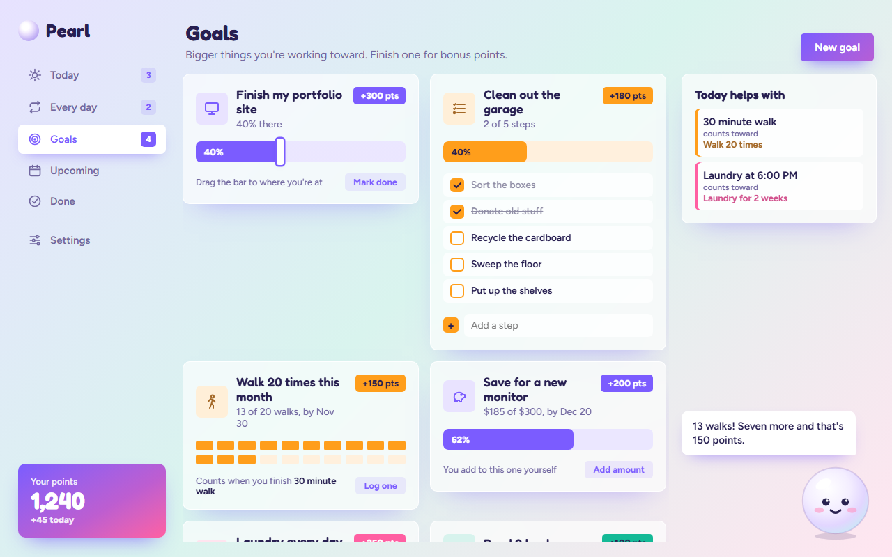
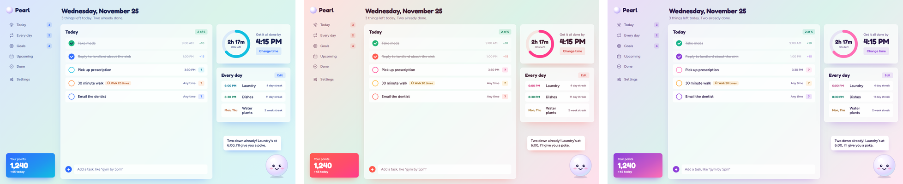
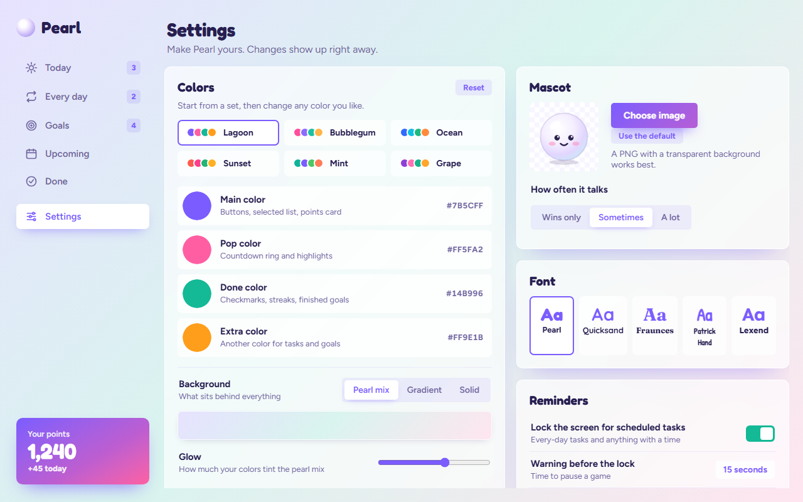

<p align="center">
  
</p>

<p align="center">
  <b>a to do app for people who know exactly what they need to do and still dont do it</b>
</p>

<p align="center">
  
  
  
  
</p>

<p align="center">
  
</p>

## why this exists

i cant make myself do normal stuff during the day unless something actually makes me. phone reminders get swiped away in half a second and then the laundry sits there for three days

so pearl doesnt let you swipe it away. when something is due it takes over your screen, and if you dismiss it anyway it keeps poking you from the corner until you admit youre doing it

<br>

## it actually stops you

<p align="center">
  
</p>

<p align="center">
  
</p>

1. **heads up.** 15 seconds before, a little bar shows up at the bottom so you can pause your game
2. **the lock.** everything goes soft and blurry with the task in the middle. start it, snooze it, or dismiss it if you really have to
3. **the nudge.** dismissed it? a small popup in the corner keeps asking if youre doing it until you say yes. these are pearls own popups, not windows notifications you can ignore

<br>

## your day

- a to do list like microsoft to do but way less clicking around
- pick a time like **4:15pm** to have everything done by and watch the countdown all day
- every day stuff like laundry, dishes or meds comes back on its own and keeps a streak going
- finishing something rolls you **random points**, and every now and then you hit a lucky roll worth triple

<br>

## goals

<p align="center">
  
</p>

for the bigger stuff. track them however makes sense:

| type | example |
| --- | --- |
| times | walk 20 times this month |
| amount | save $300 for a new monitor |
| streak | laundry every day for 2 weeks |
| weekly | in bed by 1am, 5 nights a week |
| percent | drag the bar to wherever youre at |
| steps | break it into steps and the bar fills up as you check them off |

link a goal to a task and finishing the task counts toward it automatically

<br>

## make it yours

<p align="center">
  
</p>

- six color sets to start from, or pick every color yourself
- background can be the pearl mix, a gradient or one solid color
- five fonts, from clean to handwritten
- **your own mascot.** drop in any png with no background and it becomes your little guy. no feeding it or keeping it alive, it just shows up to hype you up when you get stuff done

<p align="center">
  
</p>

<br>

## little extras

- **discord status.** show that youre on pearl. your goals stay private unless you pick one to show off, and then friends see how close you are
- **updates itself.** checks when you open it, and theres a button in settings too

<p align="center">
  
</p>

<br>

## get it

the first release isnt out yet. once it is, grab the installer from [releases](../../releases/latest) and pearl keeps itself updated from there

## where its at

- [x] the look, colors, fonts and backgrounds
- [x] goals with all six kinds of tracking
- [x] random points
- [x] discord status
- [x] updates itself
- [ ] saving your real tasks and goals
- [ ] the screen lock running on its own schedule
- [ ] mascot popping up with random stuff to say
- [ ] android, with your settings synced between both

<br>

## running it yourself

you need node and rust

```
npm install
npm run dev
```

just want to look at the ui in a browser

```
npm run preview
```

## putting out an update

```
npm run release -- 0.2.0 "what changed" "another thing that changed"
```

that bumps the version, tags it and pushes. github builds the installer, signs it and posts the release, and everyone who has pearl gets it next time they open it

<br>

<p align="center">
  <br>
  <sub>made by someone who should probably be doing laundry right now</sub>
</p>
